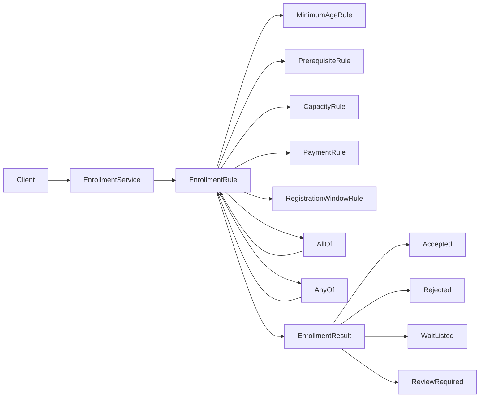

# Enrollment engine dependency diagram

The service calls the `EnrollmentRule` contract. Concrete rules and rule groups can be added without changing the service. The rule group composes policies with `allOf` or `anyOf`; each evaluation returns one permitted `EnrollmentResult` value.

`EnrollmentRule` is an open strategy because a new admission condition should be addable without editing `EnrollmentService`. `EnrollmentResult` is a sealed hierarchy because the client must handle its finite set of outcomes exhaustively.
